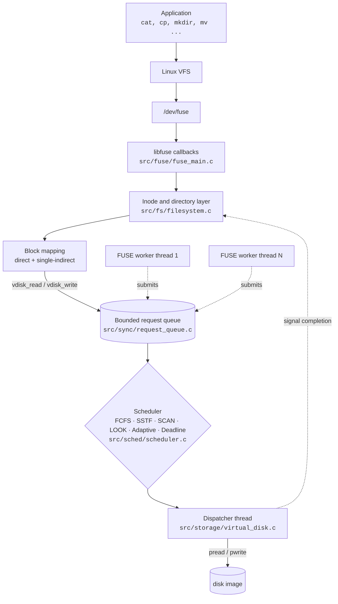
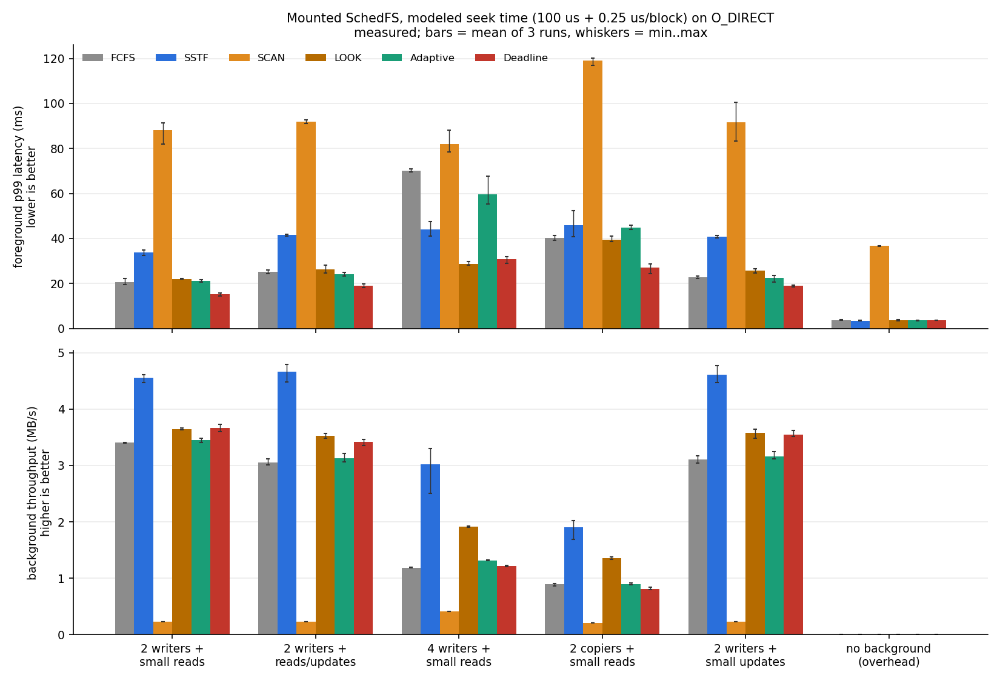
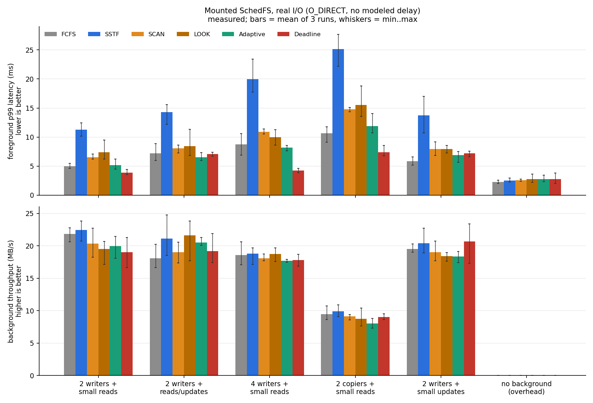
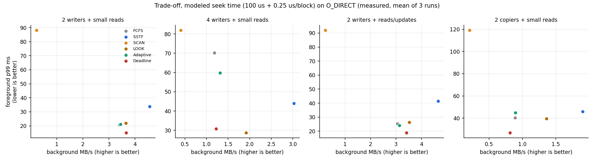
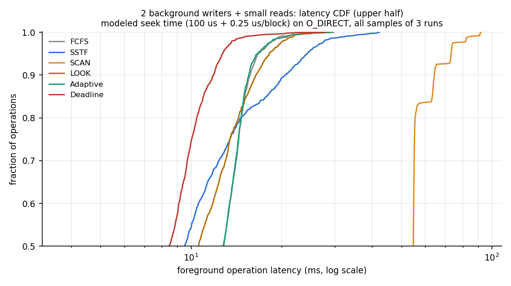

<div align="center">

# SchedFS

**A responsiveness-focused Linux file system with deadline-aware request scheduling.**


**[▶ Interactive demo](https://sharmaditya2k05.github.io/FUSE/)** · [Scheduling](docs/scheduling.md) · [Evaluation](docs/evaluation.md) · [Locking](docs/locking.md) · [Demo script](docs/demo.md) · [Testing](docs/testing.md)

</div>

---

## Aim

> Build a mountable Linux filesystem that keeps everyday file operations responsive during
> competing bulk transfers by scheduling storage requests with deadlines, while
> maintaining useful throughput for background work.

SchedFS is for shared workspaces where large background transfers (backups, imports,
large copies) and interactive file operations happen at the same time. If you are
importing a large dataset, you still want to open a config file or save your notes
without a long pause. SchedFS manages the order in which pending storage requests are
served: it generally favours nearby requests for efficiency, and serves requests that
have passed their service deadline first, so they do not keep getting overtaken.

The deliverable is the file system someone can mount and use. The benchmarks measure how
well it serves that purpose and quantify the trade-off.

## How it works



Every block the file system reads or writes becomes a request in one bounded queue. One
dispatcher thread asks the scheduler which pending request to serve next, serves it, and
wakes the caller. A small file operation is a chain of about 11 such requests (path
lookup, inode, data).

**The deadline policy** (`--sched=deadline`): each request gets a service-start deadline,
`arrival + 0 ms` for reads and `arrival + 2 ms` for writes (both configurable, tuned on a
separate workload). If any pending request is overdue, the earliest deadline is served;
otherwise the nearest block. So reads are served promptly in arrival order, writes are
ordered by locality for a short window, and nothing is overtaken indefinitely. Deadline
scheduling is an established approach (the Linux deadline I/O scheduler also gives reads
and writes separate expiry times); SchedFS's contribution is implementing it, together
with the textbook policies, in a working file system's request path and evaluating it on
mounted workloads with the same instrumentation. It is not a real-time guarantee: the
dispatcher is non-preemptive and a deadline only marks when a request becomes urgent.
Details and the exact fairness conditions: [docs/scheduling.md](docs/scheduling.md).

| Policy | Picks next |
|---|---|
| `fcfs` | oldest request |
| `sstf` | nearest block |
| `scan` | nearest block in the current direction; travels to the disk edge before reversing |
| `look` | like SCAN, but reverses at the last request |
| `adaptive` | lowest `α·distance/N − β·wait/max_wait` (heuristic baseline, no starvation guarantee) |
| `deadline` | overdue requests first (earliest deadline), else nearest block |

## Results

Measured on the mounted file system (3 runs × 10 s per cell, about 1,500 timed foreground
operations per cell, fresh image per run, identical workload and seeds for every policy).
Foreground = open + 4 KiB read or update + close of a small file every 20 ms; background =
2 or 4 processes writing (or copying) 2 MiB files continuously. Two storage
configurations: **model** adds a modeled seek time (100 µs + 0.25 µs per block moved) to
real `O_DIRECT` I/O; **direct** is real `O_DIRECT` I/O on the WSL 2 virtual disk with no
modeled delay. Full tables: [results/mounted/summary.md](results/mounted/summary.md);
method: [docs/evaluation.md](docs/evaluation.md).

**Foreground p99 latency (ms, lower is better) / background MB/s (higher is better)**

| Workload | Config | FCFS | SSTF | Deadline | Deadline vs FCFS |
|---|---|---|---|---|---|
| 2 writers + small reads | model | 20.6 / 3.40 | 33.9 / 4.56 | **15.1** / 3.66 | p99 −27%, MB/s +8% |
| 4 writers + small reads | model | 70.2 / 1.18 | 44.0 / 3.02 | **30.8** / 1.22 | p99 −56%, MB/s +3% |
| 2 copiers + small reads | model | 40.3 / 0.89 | 45.9 / 1.90 | **26.9** / 0.81 | p99 −33%, MB/s −9% |
| 2 writers + reads/updates | model | 25.2 / 3.06 | 41.5 / 4.66 | **18.9** / 3.42 | p99 −25%, MB/s +12% |
| 2 writers + small updates | model | 22.7 / 3.10 | 40.7 / 4.61 | **19.1** / 3.55 | p99 −16%, MB/s +15% |
| 2 writers + small reads | direct | 5.0 / 21.8 | 11.3 / 22.4 | **3.9** / 19.1 | p99 −22%, MB/s −13% |
| 4 writers + small reads | direct | 8.7 / 18.6 | 20.0 / 18.8 | **4.2** / 17.8 | p99 −52%, MB/s −4% |
| 2 copiers + small reads | direct | 10.6 / 9.5 | 25.1 / 9.9 | **7.4** / 9.0 | p99 −30%, MB/s −4% |
| 2 writers + reads/updates | direct | 7.2 / 18.1 | 14.3 / 21.1 | 7.1 / 19.2 | no change |
| 2 writers + small updates | direct | **5.8** / 19.5 | 13.7 / 20.4 | 7.2 / 20.7 | p99 **+24% (worse)** |
| no background (overhead), p99 only | direct · model | 2.3 · 3.7 | 2.5 · 3.5 | 2.8 · 3.6 | within run-to-run variation |

**Answer to the project question.** Compared with SchedFS's own FCFS and SSTF policies on
identical workloads, the deadline policy lowers the 99th-percentile latency of small
foreground *reads* while background processes write or copy large files: by 22–56%
against FCFS and 30–79% against SSTF in these runs. The cost: compared with SSTF it gives
up 20–60% of background throughput on the modeled-seek disk (SSTF keeps the head near the
bulk transfer); compared with FCFS, background throughput is within −13% to +15%. It does
not help foreground *updates* on the real `O_DIRECT` configuration (p99 24% worse than
FCFS), and on the modeled disk with four writers LOOK did slightly better than it
(p99 28.8 ms, 1.91 MB/s). Under no background load all policies except SCAN behave the
same. All measurements come from one Windows 11 + WSL 2 machine; "model" is a model of a
disk, not a disk.

| | |
|---|---|
|  |  |
|  |  |

The deterministic simulator (`make bench`, [results/sim_static.png](results/sim_static.png),
[results/sim_dynamic.png](results/sim_dynamic.png)) shows the same mechanisms with a
simulated clock: e.g. a distant read amid saturated nearby work waits up to 395 ms under
SSTF and Adaptive, about 2 ms under FCFS, and is served at once under the deadline policy.
Its numbers are modeled, not measured.

## What is measured and what is modeled

| | Measured | Modeled |
|---|---|---|
| Mounted experiments (`scripts/experiments.py`) | end-to-end latency of each file operation, background bytes/s, per-request queue wait, service time, queue depth (trace) | "movement" (block distance); in the `model` configuration also the service time (100 µs + 0.25 µs per block moved) |
| Simulation (`schedfs-bench`) | nothing | everything: arrivals, service times, waits (deterministic, simulated clock) |

Reduced modeled movement is never presented as an equivalent real-world speed-up. The
`direct` configuration has no modeled delay: requests reach the WSL 2 virtual disk with
`O_DIRECT`. No physical hard disk was measured.

## Quick start

Ubuntu 22.04/24.04 or WSL 2 with FUSE (or the container in [`docker/`](docker/Dockerfile)):

```sh
sudo apt install -y build-essential pkg-config libfuse3-dev fuse3 python3 python3-matplotlib
make
./mkfs.schedfs disk.img 64M
mkdir -p mnt
./schedfs disk.img mnt --sched=deadline
```

Use it like any directory, then unmount:

```sh
mkdir mnt/project
echo 'Operating Systems' > mnt/project/notes.txt
cat mnt/project/notes.txt
fusermount3 -u mnt
```

Options: `--sched=fcfs|sstf|scan|look|adaptive|deadline`, `--read-deadline-ms=N`,
`--write-deadline-ms=N`, `--alpha=N --beta=N`, `--direct-io`, `--model-base-us=N
--model-us-per-block=N`, `--queue=N`, `--trace=FILE`, `--verbose`, `-f` (foreground). Do not
run it as root; the formatter refuses to overwrite an existing image.

## Demo and experiments

```sh
scripts/demo.sh                                   # 5-minute demo (docs/demo.md)
scripts/run_mounted.sh OUT "--sched=deadline --direct-io" "--duration 10 --bg 2"
python3 scripts/analyze_run.py OUT                # one run: latency percentiles, throughput, queue
python3 scripts/experiments.py matrix results/mounted/matrix   # full evaluation (about 50 min)
python3 scripts/report_results.py results/mounted              # tables and charts
make bench && python3 scripts/plot_results.py    # deterministic simulation (results/sim_*.png)
```

Raw data for every run (foreground samples, background progress, summaries, run
metadata) is in `results/mounted/`; see [docs/evaluation.md](docs/evaluation.md).

## Tests

```sh
make unit       # scheduler (simulated clock), core, and regression tests
make test       # the same plus real FUSE mounts under all six policies
make tsan       # core and regression tests under ThreadSanitizer
scripts/check_old_defects.sh   # shows each fixed defect failing on the original code
```

[docs/testing.md](docs/testing.md) lists what each test covers.

## Review findings and fixes

| | Finding | Result |
|---|---|---|
| A | SCAN movement differed between the benchmark (edge travel, 236) and mounted metrics (208) | One movement model (`scheduler_advance`) used everywhere; SCAN (236) and LOOK (208) are separate policies; checked through the real dispatcher |
| B | Shrinking a file inside a block left the discarded bytes | Fixed: the tail of the partial block is zeroed; tested for partial blocks, exact boundaries, sparse extension, writes past the end, remount |
| C | Adaptive's age term is bounded, so distant requests can starve | Confirmed (0 picks in 10,000 decisions); Adaptive kept as a documented heuristic baseline without a guarantee |
| D | unlink without the inode lock; other races | Confirmed and fixed: inode reuse during reads/writes, duplicate names from concurrent create, rename into own subtree; metadata write ordering fixed defensively; lock order and inode lifetime documented ([locking.md](docs/locking.md)) |
| E | Benchmark claims | The benchmark is now a labelled deterministic simulation; its "concurrent" trace is renamed "interleaved"; mounted experiments are separate and measured |

## OS topics

File systems and indexed allocation (`filesystem.c`), disk scheduling (`scheduler.c`),
processes and threads (FUSE workers, the dispatcher, daemon `fork()`), producer-consumer
queues (`request_queue.c`), mutexes, condition variables and reader-writer locks,
starvation and fairness (SSTF/Adaptive starvation, deadlines), deadlock avoidance (lock
order), and performance measurement (traces, percentiles, repetitions). Mapping:
[docs/demo.md](docs/demo.md#4-mapping-to-the-os-topics).

## Project structure

```
include/          on-disk format and module interfaces
src/fs/           inodes, directories, path lookup, block allocation, locking
src/sync/         request lifecycle and the bounded producer-consumer queue
src/sched/        the six policies, the movement model, the simulator
src/storage/      image-file block device, dispatcher, modeled service time, trace
src/fuse/         libfuse 3 adapter (the `schedfs` binary)
src/bench/        simulation benchmark (`schedfs-bench`), workload (`schedfs-workload`), metrics
mkfs/             image formatter (`mkfs.schedfs`)
scripts/          experiment driver, analysis, charts, demo, old-defect check
tests/            scheduler, core, regression and mounted system tests
results/          mounted raw data and summaries, simulation charts
docs/             scheduling, locking, evaluation, demo, architecture, interactive page
report/           project report and viva guide
docker/           build and test environment
```

## Limitations

SchedFS is a teaching file system. It has no journal or crash recovery (a clean unmount
is required), no hard links, symlinks or permission enforcement, files up to 1,036 blocks
(about 4 MiB), and 256 inodes. Every operation goes through FUSE, so it is much slower
than a kernel file system (see the host-file-system reference in the results). The
deadline policy's benefit is for foreground reads during background writes; it does not
help foreground writes as much, and it classifies requests only as reads or writes. All
measurements are from one Windows 11 + WSL 2 machine; no physical hard disk was used, and
the `model` configuration's seek time is a model.
