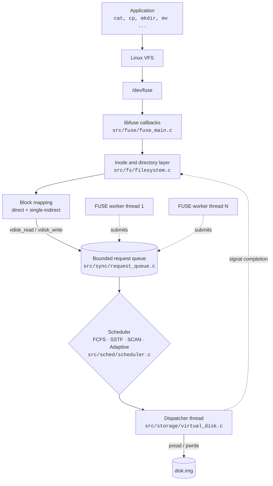
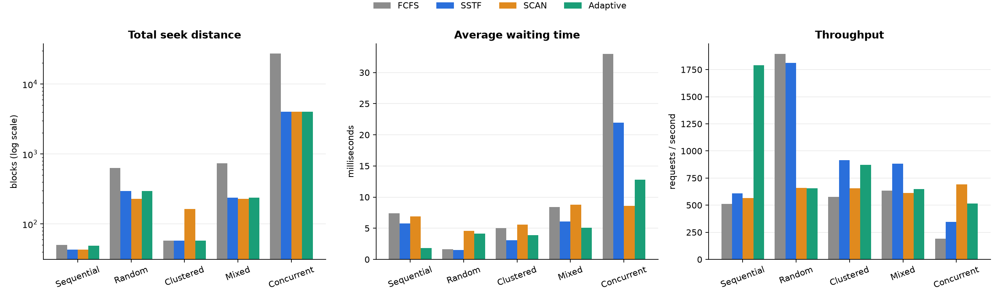
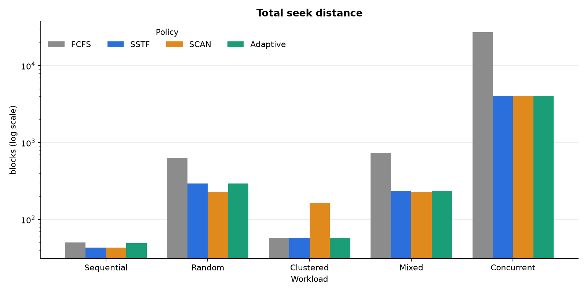
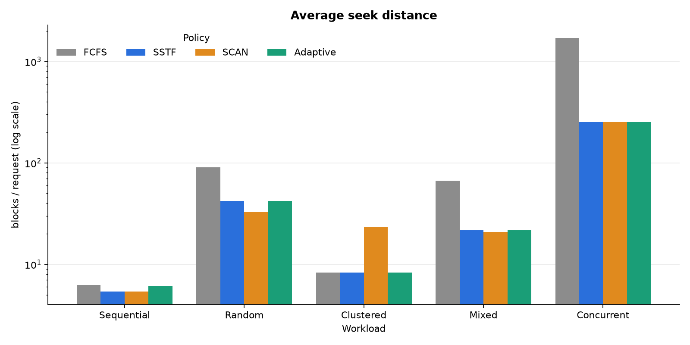
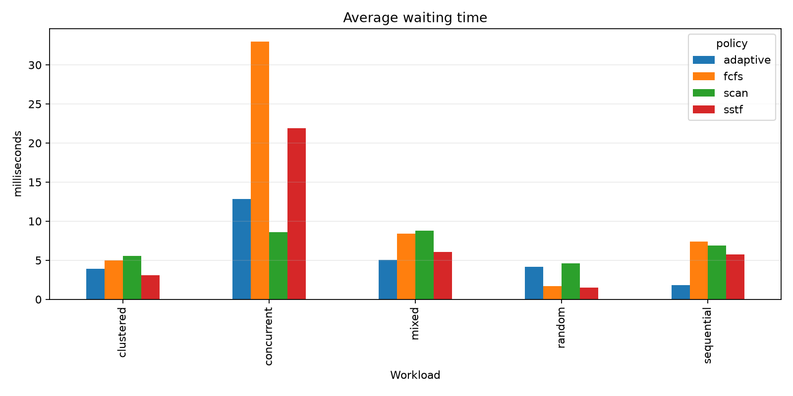
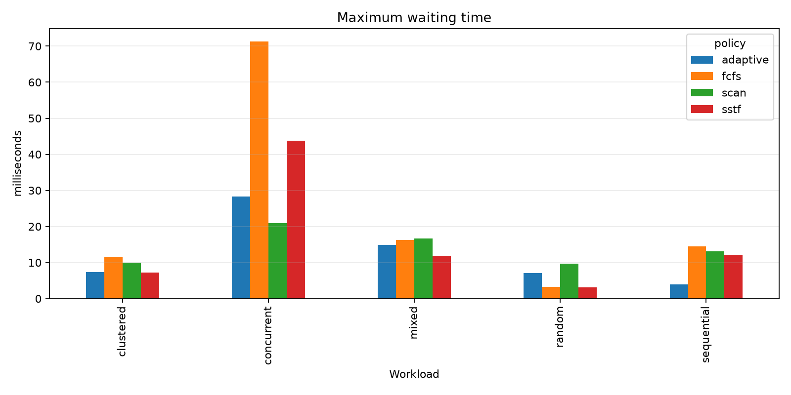
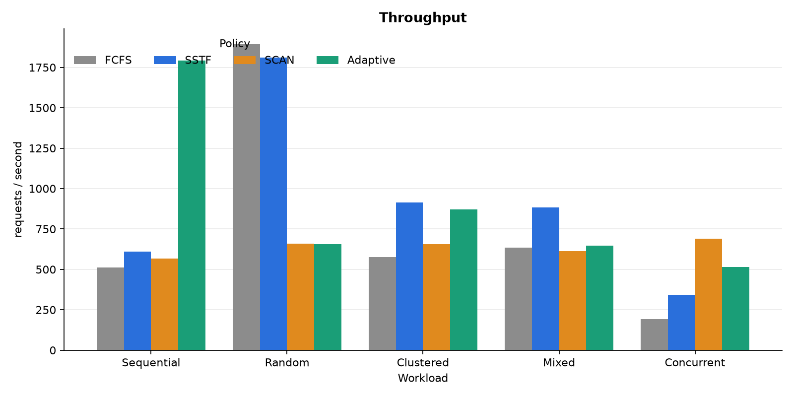
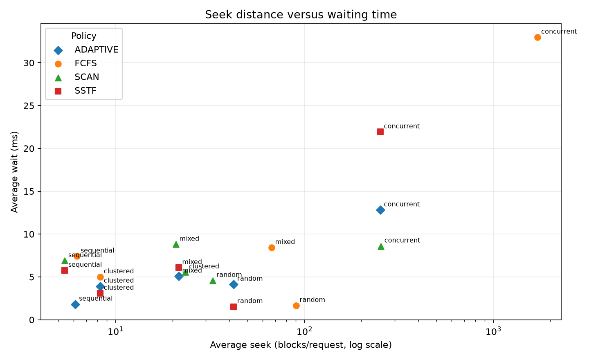

<div align="center">

# SchedFS

**A mountable FUSE file system where every disk block goes through a real disk scheduler.**


**[▶ Live interactive demo](https://sharmaditya2k05.github.io/FUSE/)** · [Architecture](docs/architecture.md) · [Implementation](docs/implementation.md) · [Testing](docs/testing.md)

</div>

---

## The idea in one paragraph

Operating-systems courses teach file systems and disk scheduling as two separate chapters. SchedFS joins them. It is a working Linux file system (you can `mkdir`, `cp`, `cat`, `mv`, `rm` inside it) whose blocks live in a single image file. Every block read or write made by the file system becomes a **request** in a shared, bounded queue. One **dispatcher thread** picks the next request using the policy chosen at mount time (**FCFS, SSTF, SCAN, or an age-aware Adaptive policy**) and only then touches the disk image. The result is that textbook scheduling algorithms run on real file-system traffic, and their effect on seek distance, waiting time and throughput can be measured.

## What it demonstrates

| OS concept | Where it shows up in SchedFS |
|---|---|
| File-system layout | Superblock, free-block bitmap, fixed 128-byte inodes, 64-byte directory entries |
| Indexed allocation | 12 direct pointers + 1 single-indirect block (1036 blocks, about 4 MiB per file) |
| Disk scheduling | FCFS, SSTF, SCAN and Adaptive, selectable with `--sched=` |
| Producer–consumer | Bounded queue with `not_empty` / `not_full` condition variables |
| Synchronization | Per-request completion condvar, inode read/write locks, a fixed lock order |
| Starvation vs. efficiency | Adaptive policy trades seek distance against request age with `alpha` / `beta` |
| User-space file systems | libfuse 3 callbacks mapped to the internal API |
| Measurement | Monotonic-clock metrics, CSV export, Matplotlib graphs |

## Architecture



After the mount-time bootstrap read, **only the dispatcher calls `pread`/`pwrite`**. A caller that submits a request sleeps on that request's own condition variable until the dispatcher signals it, so many file-system threads can be waiting while the scheduler reorders their requests.

### On-disk layout (16 MiB image, 4 KiB blocks)

```
 block 0      1         2 ........ 9      10 ................................ 4095
┌──────────┬─────────┬───────────────────┬──────────────────────────────────────┐
│Superblock│ Bitmap  │ Inode table       │ Data blocks                          │
│ magic,   │ 1 bit   │ 256 inodes ×      │ file contents, directory entries,    │
│ counts,  │ per     │ 128 bytes         │ indirect pointer blocks              │
│ offsets  │ block   │ (8 blocks)        │ (block 10 = root directory)          │
└──────────┴─────────┴───────────────────┴──────────────────────────────────────┘
```

Each inode holds mode, link count, uid/gid, size, three timestamps, **12 direct block pointers** and **one indirect pointer** (to a block of 1024 more pointers).

## Scheduling policies

| Policy | Picks next | Strength | Weakness |
|---|---|---|---|
| **FCFS** | Oldest request | Fair, no starvation | Ignores head position, so long seeks |
| **SSTF** | Closest block to the head | Low seek distance | Distant requests can starve |
| **SCAN** | Closest block in the current direction, reversing at the disk edge | Bounded wait, sweeps evenly | Extra travel to the edge |
| **Adaptive** | Lowest `alpha × distance/total_blocks − beta × wait/max_wait` | Tunable between SSTF and FCFS | Experimental, not best on every workload |

With `beta = 0` the Adaptive policy behaves exactly like SSTF; raising `beta` makes older requests win more often. Ties are always broken by arrival time and then request ID, so every run is deterministic.

### Worked example (the classic textbook trace)

Head at block **53**, queue `98, 183, 37, 122, 14, 124, 65, 67`. This exact case is checked by `tests/test_scheduler.c`:

| Policy | Service order | Total head movement |
|---|---|---|
| FCFS | 98 → 183 → 37 → 122 → 14 → 124 → 65 → 67 | **640** blocks |
| SSTF | 65 → 67 → 37 → 14 → 98 → 122 → 124 → 183 | **236** blocks |
| SCAN (moving toward 0) | 37 → 14 → *(0)* → 65 → 67 → 98 → 122 → 124 → 183 | **236** blocks |

You can step through this trace, and the benchmark traces, in the **[interactive demo](https://sharmaditya2k05.github.io/FUSE/)** (source in [`docs/index.html`](docs/index.html)).

## Results

`make bench` replays five fixed traces under every policy, so all policies see identical input. FCFS, SSTF and SCAN seek distances are exact and repeat on every run; Adaptive reads the real clock to measure waiting time, so its choices (and seek totals) can shift slightly between runs. Timing uses a small seek-delay model (10 µs + 2 µs per block moved) so that differences show up on SSDs and virtual machines.



**Total seek distance (blocks), lower is better:**

| Workload | FCFS | SSTF | SCAN | Adaptive |
|---|---:|---:|---:|---:|
| Sequential | 50 | 43 | 43 | 49 |
| Random | 631 | 295 | **229** | 295 |
| Clustered | 58 | 58 | 164 | 58 |
| Mixed | 736 | 237 | **229** | 237 |
| Concurrent | 27 402 | **4 029** | 4 053 | **4 029** |

**Average waiting time (ms), lower is better:**

| Workload | FCFS | SSTF | SCAN | Adaptive |
|---|---:|---:|---:|---:|
| Mixed | 8.42 | 6.08 | 8.80 | **5.08** |
| Concurrent | 32.98 | 21.93 | **8.60** | 12.81 |

**What the numbers say**

- On the concurrent trace, FCFS moves the head **6.8× farther** than SSTF (27 402 vs 4 029 blocks).
- SCAN cuts average waiting time on the concurrent trace by **74 %** compared with FCFS, and by 61 % compared with SSTF, because it never leaves requests stranded behind the head.
- On clustered requests SCAN is the *worst*: it travels to the disk edge even though every request is nearby. No single policy wins everywhere, which is the motivation for the Adaptive policy.

<details>
<summary>All graphs</summary>

| | |
|---|---|
|  |  |
|  |  |
|  |  |

</details>

## Quick start

Ubuntu 22.04 or 24.04 is recommended (WSL 2 works for build and benchmarks).

```sh
sudo apt update
sudo apt install -y build-essential pkg-config libfuse3-dev fuse3 python3-pandas python3-matplotlib
```

Build, format an image and mount it:

```sh
make
./mkfs.schedfs disk.img 16M
mkdir -p mnt
./schedfs disk.img mnt --sched=sstf
```

Use it like any other directory, from another terminal:

```sh
mkdir mnt/project
echo 'Operating Systems' > mnt/project/demo.txt
cat mnt/project/demo.txt
cp mnt/project/demo.txt mnt/project/copy.txt
stat mnt/project/copy.txt
truncate -s 8192 mnt/project/copy.txt
mv mnt/project/copy.txt mnt/project/result.txt
rm mnt/project/demo.txt mnt/project/result.txt
rmdir mnt/project
fusermount3 -u mnt
```

Other policies:

```sh
./schedfs disk.img mnt --sched=fcfs
./schedfs disk.img mnt --sched=scan
./schedfs disk.img mnt --sched=adaptive --alpha=0.7 --beta=0.3
```

Add `-f` to keep FUSE in the foreground and `--verbose` for DEBUG logging to `filesystem.log`. The formatter refuses to overwrite an existing image, and FUSE should not be run as root.

## Benchmarks and tests

```sh
make bench                       # writes benchmark.csv
python3 scripts/plot_results.py  # writes results/*.png
make test                        # unit, core and mounted FUSE tests
```

| Test | What it checks |
|---|---|
| `tests/test_scheduler.c` | Textbook head-53 trace: exact service order and head movement for FCFS, SSTF, SCAN |
| `tests/test_core.c` | Create/write/read/truncate, sparse reads, 4 threads writing 64 KiB each concurrently, and persistence across unmount and remount under a different policy |
| `tests/system.sh` | Formats a fresh image, mounts it under **each** policy, and runs `mkdir`, write, `cmp`, `truncate`, `mv`, `rm`, `rmdir`, unmount |

See [docs/testing.md](docs/testing.md) for AddressSanitizer and Valgrind runs.

## Project structure

```
include/          on-disk format and module interfaces
src/fs/           inodes, directories, path lookup, block allocation
src/sync/         request lifecycle and the bounded producer-consumer queue
src/sched/        FCFS, SSTF, SCAN and Adaptive selection
src/storage/      image-file block device and the dispatcher thread
src/fuse/         libfuse 3 adapter (the `schedfs` binary)
src/bench/        trace replay benchmark (`schedfs-bench`) and metrics
mkfs/             image formatter (`mkfs.schedfs`)
scripts/          workload generator and graph plotting
tests/            scheduler, core and mounted system tests
docs/             architecture, implementation, testing, interactive demo
```

## Limitations

SchedFS is a teaching file system, not a production one. It has no journal or crash recovery, no hard links, symlinks, extended attributes or ACL enforcement, and no block cache. Seek distance models block-number movement only; it does not represent SSD behaviour, rotational latency or device caches. `rename` refuses to replace an existing target. The image format is native little-endian and intended for Linux/x86-64.

## Future work

- Journaling and a consistency checker (`fsck`)
- C-SCAN and LOOK / C-LOOK policies
- A concurrent benchmark harness with controlled producer arrival barriers
- A block cache, to study how caching changes the value of scheduling
